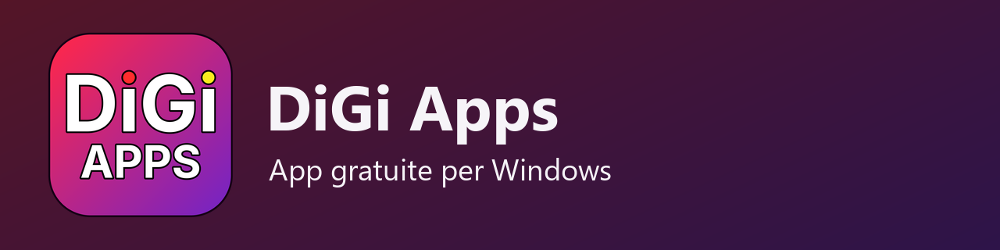
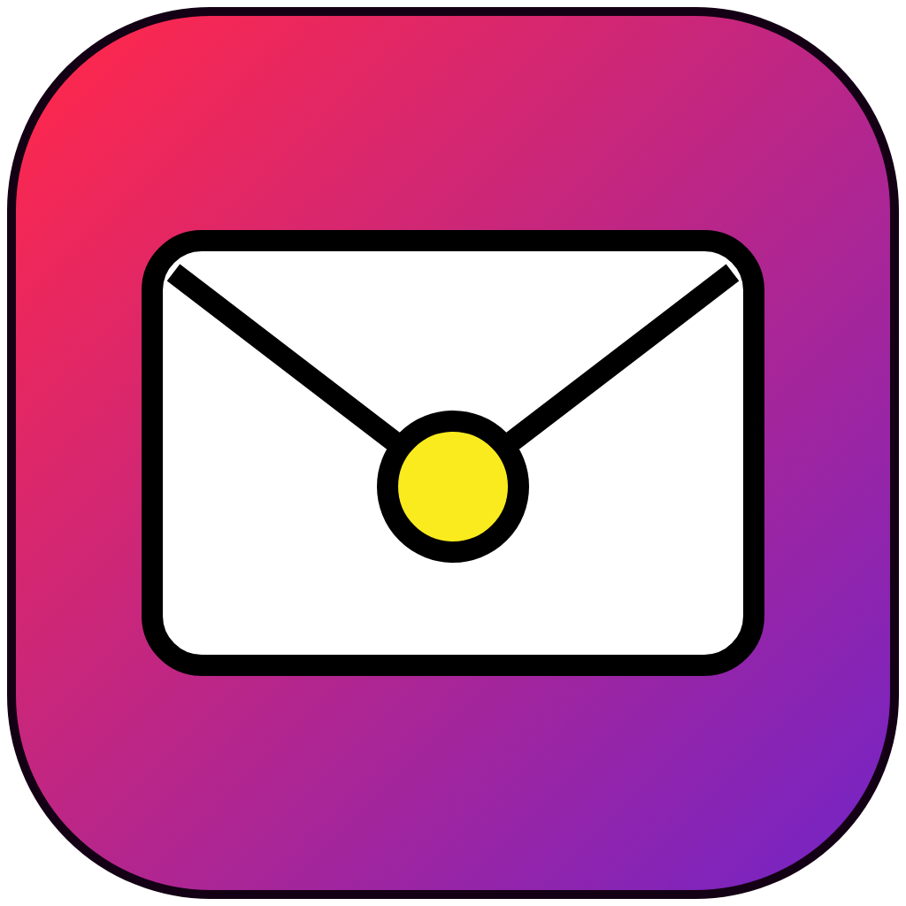
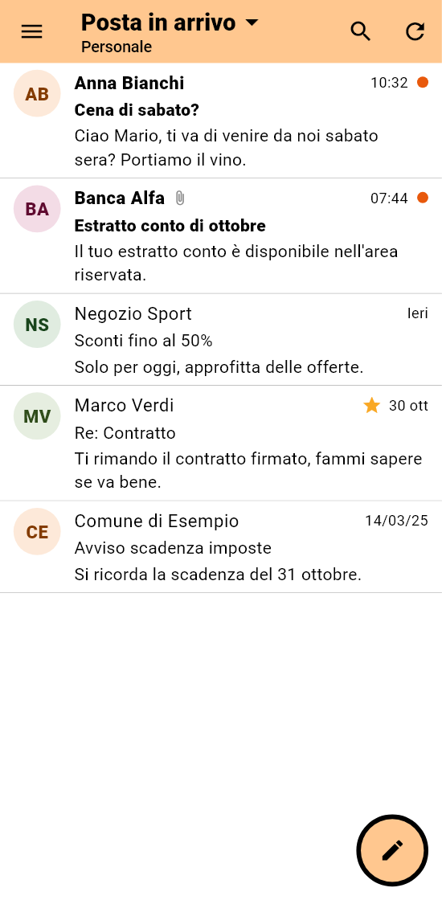
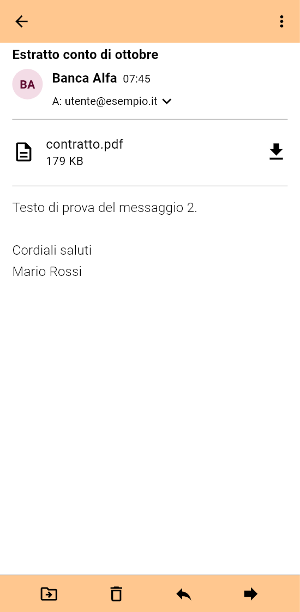
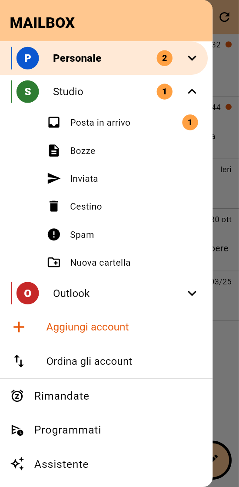
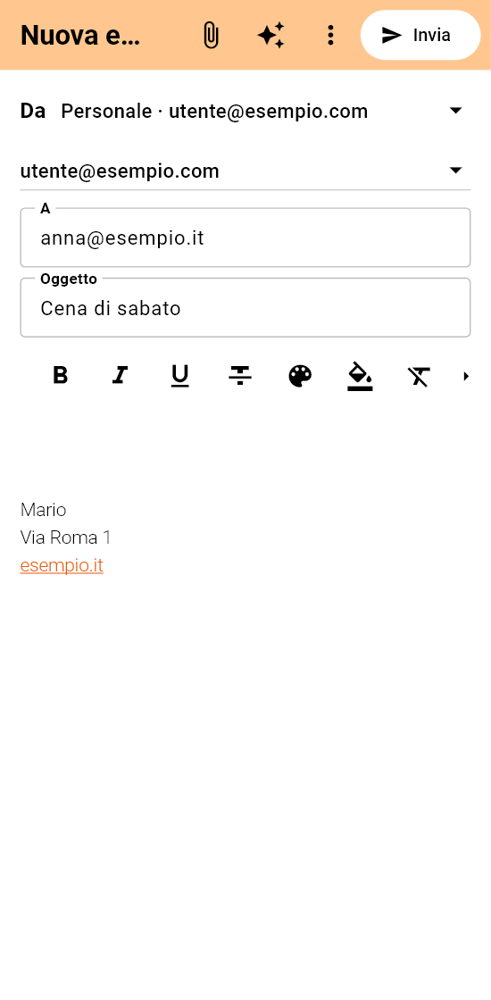

<p align="center">
  
</p>

<p align="center">
  
</p>

# DiGiMail

## ✉️ Tutte le tue caselle email in un'app Android

### ⬇️ [Scarica DiGiMail](https://github.com/DiGi-Apps-Dev/DiGiMail/releases/latest)

Gmail, Outlook, iCloud, Yahoo e qualunque casella IMAP, ognuna con il suo nome, colore e suono. Le email e le password restano sul tuo telefono: DiGiMail non ha un server suo. DiGiMail fa parte di **DiGi Apps**, app gratuite.

### Cosa fa

- **Più caselle**, ognuna con nome, logo, colore, firma e alias. Si aggiungono con il rilevamento automatico dei server.
- **Avvisi immediati**: l'app resta collegata alle caselle (IMAP IDLE) e suona appena arriva un'email, con un suono diverso per ogni casella.
- **Rispondi ed Elimina dalla notifica**: rispondi con una frase o elimina l'email senza aprire l'app. Tutto resta allineato con il server.
- **Gesti** a scelta (corto e lungo, a destra e a sinistra), selezione multipla e **Annulla** dopo ogni azione.
- **Rimanda** un'email a più tardi, **programma** un invio, ritira un invio nei secondi dopo averlo mandato.
- **Regole** per spostare, archiviare, eliminare o segnare le email in automatico, e **mittenti bloccati** che finiscono nello spam.
- **Senza rete** le azioni restano in coda e partono da sole appena torna la connessione.
- **Copia completa** cifrata con una parola tua: caselle, firme, regole e impostazioni passano su un telefono nuovo in un file solo.
- **Blocco con impronta** e anteprima nascosta sulla schermata di blocco.

Con la tua chiave Cloudflare (facoltativa):

- **Riassumi** un'email lunga in pochi punti.
- **Rispondi con IA**: una bozza di risposta, nel tono che scegli.
- **Scrivi con IA** e **Cerca con IA** nelle tue email.

## Come si vede

| | |
|---|---|
|  |  |

| | |
|---|---|
|  |  |

## Installazione

DiGiMail non è sul Play Store: si installa dal file APK.

1. Dalla pagina **Releases** scarica `DiGiMail-<versione>.apk` sul telefono.
2. Aprilo. Android chiede di permettere l'installazione dall'app con cui l'hai aperto, di solito Chrome o Archivio: permettila.
3. Se compare Play Protect, scegli di installare comunque: l'app non viene dal Play Store e Google non la conosce.

Al primo avvio DiGiMail chiede le notifiche. Per avere gli avvisi subito anche a telefono fermo, escludi DiGiMail dal risparmio batteria: c'è il pulsante in **Impostazioni › Notifiche**.

## Aggiungere una casella

1. Tocca **Aggiungi casella** e scegli il fornitore, oppure **Altro (IMAP)**.
2. Scrivi indirizzo e password. I server di posta in arrivo e in uscita si trovano da soli; se no, li scrivi tu.

Note per i fornitori più comuni:

- **Gmail e Yahoo** non accettano la password normale: crea una **password per le app** nelle impostazioni di sicurezza del tuo account (serve la verifica in due passaggi) e usa quella.
- **iCloud**: anche qui serve una **password specifica per le app**, da [account.apple.com](https://account.apple.com).
- **Outlook, Hotmail e Live** usano l'accesso Microsoft. Serve una volta sola un «ID applicazione» registrato da te: su [Microsoft Entra](https://entra.microsoft.com) crea una registrazione d'app per **account Microsoft personali**, attiva **Consenti flussi client pubblici** e aggiungi le autorizzazioni `IMAP.AccessAsUser.All`, `SMTP.Send` e `offline_access`. Poi incolla l'ID nel campo **ID applicazione Microsoft** di DiGiMail e premi **Accedi con Microsoft**.

## Attivare l'intelligenza artificiale

L'IA è facoltativa e parte solo quando tocchi un tasto (Riassumi, Rispondi con IA, Scrivi con IA, Cerca con IA). Usa **Cloudflare Workers AI** con la tua chiave: il piano gratuito di Cloudflare basta per l'uso normale.

1. Crea un account gratuito su [cloudflare.com](https://dash.cloudflare.com/sign-up).
2. Copia il tuo **ID account**: lo trovi nella pagina **Workers AI** o nella barra dell'indirizzo del pannello, dopo `dash.cloudflare.com/`.
3. Crea una chiave in **Profilo › Token API › Crea token**, partendo dal modello **Workers AI** (permesso *Workers AI: Read* ed *Edit*).
4. In DiGiMail apri **Impostazioni › IA con Cloudflare**, incolla ID account e chiave e premi **Salva e prova**.

La chiave resta solo nella memoria cifrata del telefono, non è nel codice e non va da nessun'altra parte. Quando usi un tasto IA, il testo di quell'email va a Cloudflare. Il modello si cambia nello stesso schermo; quello predefinito è `@cf/openai/gpt-oss-120b`.

## Privacy

- Email, rubrica e impostazioni restano sul telefono, nel database privato dell'app.
- Password, token e chiave IA stanno nella memoria cifrata di Android.
- Nessuna statistica, nessun server di DiGiMail. L'unico invio esterno, oltre ai tuoi server di posta, è il testo che mandi all'IA quando la usi.

## Requisiti

- Android 7 o più recente.
- Una casella con accesso IMAP e SMTP.
- Per l'IA, un account Cloudflare tuo (facoltativo).

## Compilare il codice

Serve Flutter 3.35.

```bash
flutter pub get
flutter test
flutter build apk --release
```

Se manca `android/key.properties`, l'APK si firma con la chiave di debug. Non mettere mai la tua chiave di firma nel repository.

## Licenza

MIT: vedi [LICENSE](LICENSE).
